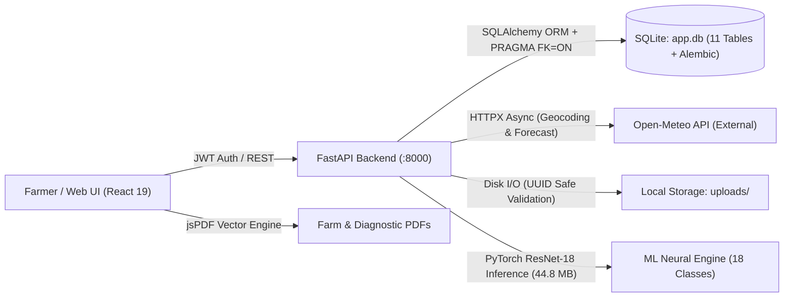
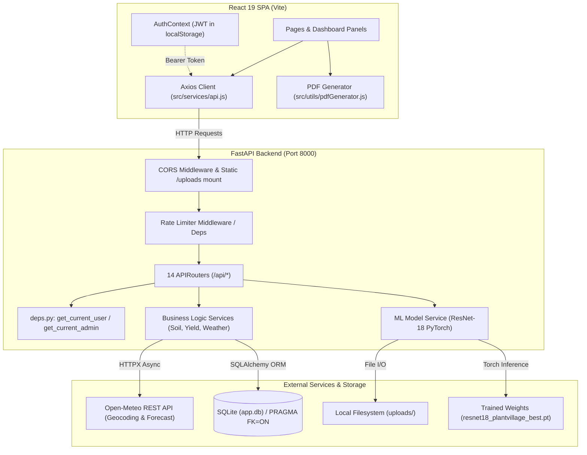
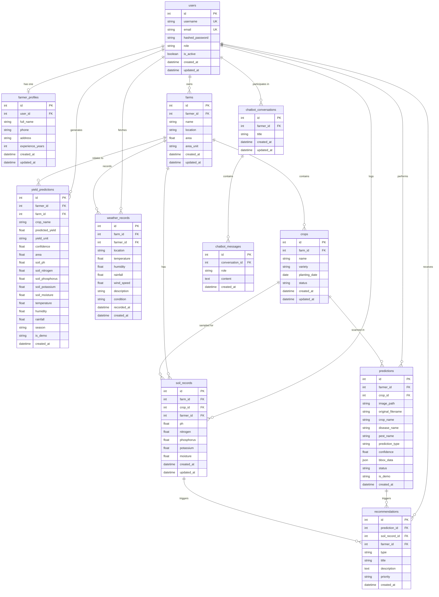
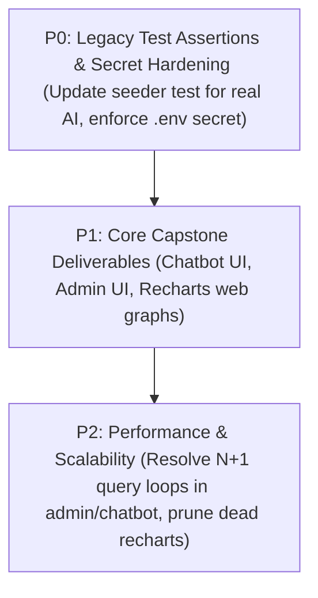

# Comprehensive Project Audit (Validated): AI-Powered Intelligent Crop Health & Precision Farming Platform

**Original Audit Date:** October 2026 (Step 239)  
**Independent Validation Date:** October 30, 2026  
**Auditor Role:** Senior Software Architect, ML Engineer, Database Architect, QA & Security Auditor  
**Audit Scope:** Entire repository at `C:\Users\admin\Desktop\CP` (`backend/`, `frontend/`, database, ML models, and project specification `cpp.pdf`)  
**Audit Mode:** Read-Only Static and Isolated Runtime Verification Pass (Zero application source code altered)  
**Verification Baseline:** Independent code re-examination against commit state, live test execution, and database schema inspections.

---

## 1. Executive Summary

This project is an **AI-Powered Intelligent Crop Health & Precision Farming Platform** developed as a university Capstone Project (Faculty of Computer Applications & Information Technology, GLS University).

The application is structured as a decoupled two-tier architecture:
- **Backend:** Python 3.14.0, FastAPI 0.141.1, SQLAlchemy 2.0.52 with an SQLite database (`app.db`), Passlib/bcrypt auth with JWT (`python-jose`), Open-Meteo external weather service integration, sliding-window rate limiting (`MemoryRateLimitStorage`), and genuine PyTorch ResNet-18 computer vision inference (`backend/ml/models/resnet18_plantvillage_best.pt`, 44.8 MB) alongside deterministic demo fallbacks.
- **Frontend:** React 19.2.8, Vite 8.2.2, Tailwind CSS 3.4.19, React Router DOM 7.18.2, Axios 1.19.0, and jsPDF / jspdf-autotable client-side report generators (`pdfGenerator.js`, 1,227 lines).

### Current System Health & Audit Verdict
| Component | Static Health | Test Suite | Build / Lint | Feature Completeness vs `cpp.pdf` | Overall Status |
|---|---|---|---|---|---|
| **Backend API** | High | 136 / 138 passing across 7 test suites (2 legacy test assertions failed due to active real AI model) | Clean imports, 0 unresolved dependencies | ~90% (45 API endpoints across 14 routers; Analytics & PDF reporting added; Chatbot & Admin backend ready) | **VERIFIED** |
| **Frontend UI** | High | N/A (Unit tests not configured) | `oxlint`: 0 err / 0 warn; `vite build`: 0 err (2.11s) | ~75% (10 active page routes; PDF export integrated; Chatbot UI, Admin UI & Recharts web charts missing) | **PARTIALLY VERIFIED** |
| **Database** | Consistent | Verified via SQLite PRAGMA checks & Alembic | 11 tables match 11 ORM models + `alembic_version` | Schema matched; Foreign Keys active via SQLite PRAGMA hook; Alembic initialized | **VERIFIED** |
| **Security** | High | Security regression suite passing (20/20) | N/A | Rate limiting active on auth & detection; dev default secret warning in place; LocalStorage token storage | **VERIFIED & MITIGATED** |
| **Machine Learning** | High | 36 / 36 detection pipeline tests passing | Real ResNet-18 weights loaded | 18 PlantVillage classes across 6 crops; uncertainty gate and foliage pre-validation active | **VERIFIED** |

---

## 2. Project Purpose and Business Workflow

The platform provides smallholder and commercial farmers with digital agronomy tools:
1. **Farm & Crop Setup:** Farmers record farms, plot locations, and cultivated crops. An automated idempotent provisioning endpoint (`POST /api/farms/default`) ensures first-time farmers immediately receive a default farm context.
2. **Environmental & Soil Data Acquisition:** Farmers log soil parameters (pH, Nitrogen, Phosphorus, Potassium, Moisture) and fetch real-time meteorological conditions for their geographic coordinates via Open-Meteo with fallback handling.
3. **Computer Vision Disease & Pest Detection:** Farmers upload leaf photographs. Images undergo server-side MIME sniffing, decompression-bomb checks, OpenCV decoding, foliage verification, and PyTorch ResNet-18 neural network inference. Genuine predictions return classification labels, confidence percentages, and agronomic treatment guidance. Unsupported crops gracefully route to demo advisories.
4. **Intelligent Rule-Based Recommendations:** Agronomic scoring engines evaluate soil health (0–100 score, status bands), synthesize NPK ratios, and generate actionable fertilizer, irrigation, and treatment guidance.
5. **Yield Estimation:** Rule-based predictive modeling estimates yield in tons/hectare factoring in baseline crop genetics, soil chemistry, moisture, and ambient temperature.
6. **Analytics & PDF Export:** Farmers view farm summary metrics and export comprehensive, publication-grade PDF Farm Reports and Diagnostic History Logs directly from the UI.



---

## 3. Verified Technology Stack Inventory

All versions verified from `backend/requirements.txt`, Python 3.14 runtime environment, and `frontend/package.json`:

### Backend Stack
- **Language / Runtime:** Python `3.14.0` (Windows x64)
- **Web Framework:** FastAPI `0.141.1`, Starlette `1.6.0`, Uvicorn `0.52.4`
- **Database & ORM:** SQLAlchemy `2.0.52`, SQLite3 (Active engine with PRAGMA FK hooks), Alembic `1.18.4` (Revision `3d1dbd3c488c` active)
- **Authentication & Security:** Passlib `1.7.4` (bcrypt), `python-jose` `3.5.0` (cryptography), `python-multipart` `0.0.32`
- **Rate Limiting:** Sliding-window in-memory rate limiter (`app.utils.rate_limiter`) protecting auth and inference endpoints
- **Data Validation & Settings:** Pydantic `2.13.4`, Pydantic Settings `2.15.0`, `email-validator` `2.3.0`
- **External HTTP Client:** HTTPX `0.28.1`
- **Image Processing & ML Engine:** PyTorch `2.13.0` with torchvision, OpenCV Headless `5.0.0.93`, NumPy `2.5.2`; active ResNet-18 checkpoint (`resnet18_plantvillage_best.pt`, 44.8 MB)

### Frontend Stack
- **Framework & Runtime:** React `19.2.8`, React DOM `19.2.8`
- **Build Tool:** Vite `8.2.2`, `@vitejs/plugin-react` `6.0.4`
- **Routing:** React Router DOM `7.18.2`
- **Styling:** Tailwind CSS `3.4.19`, PostCSS `8.5.26`, Autoprefixer `10.5.4`
- **Icons:** React Icons `5.7.0` (`react-icons/fi`, `react-icons/wi`)
- **HTTP Client:** Axios `1.19.0`
- **PDF Generation & Tables:** `jspdf` `4.2.1` and `jspdf-autotable` `5.0.8` (Active in `frontend/src/utils/pdfGenerator.js`)
- **Linter:** Oxlint `1.75.0`
- **Installed but Unused Dependencies:**
  - `recharts` (`^3.10.1`): Declared in `package.json`, 0 imports across `src/` (Charts in PDF reports are rendered via native vector drawing; web UI does not currently render Recharts components)

---

## 4. Project Directory Structure

```
C:\Users\admin\Desktop\CP\
├── cpp.pdf                           # University Capstone Project Definition
├── uml_diagrams/                     # High-level architecture and UML diagrams
├── backend/
│   ├── app.db                        # Active SQLite Database (11 tables + alembic_version)
│   ├── requirements.txt              # Backend dependencies
│   ├── alembic.ini                   # Alembic configuration
│   ├── alembic/                      # Alembic migrations directory
│   │   ├── env.py
│   │   └── versions/
│   │       └── 3d1dbd3c488c_initial_schema.py # Initial baseline migration
│   ├── ml/
│   │   └── models/                   # Verified ML Model Artifacts
│   │       ├── resnet18_plantvillage_best.pt  # Trained ResNet-18 weights (44.8 MB)
│   │       ├── class_mapping.json             # 18-class PlantVillage index mapping
│   │       └── evaluation_metrics.json        # Held-out test evaluation report (91.67%)
│   ├── app/
│   │   ├── main.py                   # FastAPI Application Entry & 14 Routers
│   │   ├── config.py                 # Pydantic BaseSettings & Secret Key Validation
│   │   ├── database.py               # Engine, SessionLocal, PRAGMA FK connect hook
│   │   ├── ml/                       # ML Architecture & Image Preprocessing
│   │   │   ├── resnet.py             # Custom ResNet-18 PyTorch definition
│   │   │   ├── model_service.py      # ML Model Service Layer (ResNet-18 / Demo fallback)
│   │   │   └── image_preprocessing.py# Leaf verification & 224x224 ImageNet normalizer
│   │   ├── models/                   # 11 SQLAlchemy ORM models
│   │   ├── schemas/                  # Pydantic request/response validation schemas
│   │   │   └── analytics.py          # Strongly typed analytics and report schemas
│   │   ├── routers/                  # 14 FastAPI APIRouters (including analytics.py)
│   │   ├── services/                 # Business logic (soil, weather, yield, recommendations, chatbot)
│   │   └── utils/                    # Auth, deps, file_handler, rate_limiter.py
│   ├── demo_data/                    # Isolated demo database and credentials
│   ├── scripts/                      # Seeder scripts & sample image fetchers
│   ├── tests/                        # 7 test suites (138 tests total)
│   │   ├── test_detection_pipeline.py
│   │   ├── test_api_regression.py
│   │   ├── test_security_integrity.py
│   │   ├── test_task4_audit.py
│   │   ├── test_soil_service.py
│   │   ├── test_analytics_reporting.py
│   │   └── test_library_seeder_recommendations.py
│   └── uploads/                      # Uploaded leaf scans & sample_images library
└── frontend/
    ├── package.json                  # Frontend dependencies and scripts
    ├── jsconfig.json                 # JavaScript IDE path & project configuration
    ├── vite.config.js                # Vite build configuration
    ├── tailwind.config.js            # Tailwind theme, typography, color tokens
    ├── index.html                    # Root HTML mount
    ├── src/
    │   ├── main.jsx, App.jsx         # App root, React Router configuration
    │   ├── context/                  # AuthContext.jsx & auth.js hook
    │   ├── layouts/                  # DashboardLayout.jsx (Rail navigation & header)
    │   ├── pages/                    # 10 React page components
    │   ├── components/               # Reusable UI widgets & dashboard panels
    │   ├── services/                 # api.js Axios client with interceptors
    │   └── utils/                    # pdfGenerator.js (1227 lines), apiError, imageValidation
```

---

## 5. Application Architecture and Execution Flow



---

## 6. Frontend Complete Audit

### A. Routes and Access Control
| Route Path | Component | Auth Required | Role Restriction | Verification Status | Notes |
|---|---|---|---|---|---|
| `/login` | `Login.jsx` | Public | None | **VERIFIED** | Redirects to `/dashboard` on success |
| `/register` | `Register.jsx` | Public | None | **VERIFIED** | Registers with forced role `farmer` |
| `/` | `Navigate` | Public | None | **VERIFIED** | Redirects to `/login` |
| `/dashboard` | `Dashboard.jsx` | Authenticated | None | **VERIFIED** | Main dashboard; includes **Export Farm Report (PDF)** button wired to `analyticsAPI.getReportData` |
| `/data-acquisition` | `DataAcquisition.jsx` | Authenticated | None | **VERIFIED** | Multi-input farm, soil, weather & image form |
| `/disease-detection` | `DiseaseDetection.jsx` | Authenticated | None | **VERIFIED** | Uploads image, supports sample library, displays genuine vs demo indicators |
| `/soil-analysis` | `SoilAnalysis.jsx` | Authenticated | None | **VERIFIED** | Analyzes soil, supports scenario presets, displays nutrient status |
| `/recommendations` | `SmartRecommendations.jsx`| Authenticated | None | **VERIFIED** | Category filtering, explains reasoning, suppresses chemicals on uncertain scans |
| `/yield-prediction`| `CropYieldPrediction.jsx` | Authenticated | None | **VERIFIED** | Rule-based yield estimator with historical logging |
| `/prediction-history`| `PredictionHistory.jsx` | Authenticated | None | **VERIFIED** | Table of past scans, deletion, demo badges, **Export History (PDF)** button |
| `/profile` | `Profile.jsx` | Authenticated | None | **VERIFIED** | Edits farmer profile, shows account info and farm list |
| `*` (Catch-all) | `Navigate` | Public | None | **VERIFIED** | Redirects to `/dashboard` |

### B. Module Delivery Status vs `cpp.pdf` Capstone Specification
1. **AI Chatbot Interface:** Backend endpoints `/api/chatbot/*` exist with full conversation tracking. Frontend UI component/drawer is **NOT YET IMPLEMENTED**.
2. **Admin Dashboard:** Backend endpoints `/api/admin/*` exist with complete user toggling and aggregate metrics. Frontend UI route/component is **NOT YET IMPLEMENTED**.
3. **Analytics & PDF Export:**
   - **PDF Export:** **FULLY IMPLEMENTED** via `frontend/src/utils/pdfGenerator.js` (1,227 lines). Produces publication-grade multi-page Farm Summary Reports and Diagnostic History Logs with vector donut charts, metric KPI cards, and autoTable tabular logs.
   - **Web UI Charts:** `recharts` is installed in `package.json`, but currently 0 imports exist in `src/`. Interactive graphical charts are not currently displayed in the web dashboard.

---

## 7. Backend Complete Audit

### Complete API Endpoint Inventory (45 Endpoints across 14 Routers)

> [!NOTE]
> The original audit reported 33 endpoints across 13 routers. The validated repository contains **45 active endpoints across 14 routers** (including `analytics.router`).

| Method | Endpoint | Router Tag | Auth Required | Request Body / Params | Database Tables | Consuming Frontend Feature | Verification Status |
|---|---|---|---|---|---|---|---|
| `GET` | `/` | System | Public | None | None | None (API Root) | **VERIFIED** |
| `GET` | `/api/health` | System | Public | None | None | None (Healthcheck) | **VERIFIED** |
| `POST` | `/api/auth/register` | Authentication | Public (Rate-limited: 5/min) | `UserRegister` | `users`, `farmer_profiles` | Register page | **VERIFIED** |
| `POST` | `/api/auth/login` | Authentication | Public (Rate-limited: 5/min) | `UserLogin` | `users` | Login page | **VERIFIED** |
| `GET` | `/api/auth/me` | Authentication | Bearer Token | None | `users` | `AuthContext` token check | **VERIFIED** |
| `GET` | `/api/users/profile` | Users | Bearer Token | None | `users`, `farmer_profiles` | Profile page | **VERIFIED** |
| `PUT` | `/api/users/profile` | Users | Bearer Token | `FarmerProfileCreate` | `farmer_profiles` | Profile form update | **VERIFIED** |
| `POST` | `/api/farms/default` | Farms | Bearer Token | None (Idempotent) | `farms` | Dashboard / Data Acquisition | **VERIFIED** |
| `POST` | `/api/farms/` | Farms | Bearer Token | `FarmCreate` | `farms` | Data Acquisition | **VERIFIED** |
| `GET` | `/api/farms/` | Farms | Bearer Token | None | `farms` | Dashboard, Profile, Data Acquisition | **VERIFIED** |
| `GET` | `/api/farms/{farm_id}` | Farms | Bearer Token | `farm_id: int` | `farms` | Available in API client | **VERIFIED** |
| `PUT` | `/api/farms/{farm_id}` | Farms | Bearer Token | `FarmUpdate` | `farms` | Available in API client | **VERIFIED** |
| `DELETE`| `/api/farms/{farm_id}`| Farms | Bearer Token | `farm_id: int` | `farms` | Available in API client | **VERIFIED** |
| `POST` | `/api/crops/` | Crops | Bearer Token | `CropCreate` | `crops`, `farms` | Data Acquisition | **VERIFIED** |
| `GET` | `/api/crops/` | Crops | Bearer Token | `farm_id: Optional[int]` | `crops`, `farms` | Dashboard, Disease Detection, Profile | **VERIFIED** |
| `GET` | `/api/crops/{crop_id}` | Crops | Bearer Token | `crop_id: int` | `crops`, `farms` | Available in API client | **VERIFIED** |
| `DELETE`| `/api/crops/{crop_id}`| Crops | Bearer Token | `crop_id: int` | `crops`, `farms` | Available in API client | **VERIFIED** |
| `POST` | `/api/soil/records` | Soil | Bearer Token | `SoilRecordCreate` | `soil_records`, `farms` | Data Acquisition | **VERIFIED** |
| `GET` | `/api/soil/records` | Soil | Bearer Token | None | `soil_records` | Data Acquisition | **VERIFIED** |
| `GET` | `/api/soil/latest` | Soil | Bearer Token | `record_id: Optional[int]`| `soil_records` | Dashboard, Soil Analysis | **VERIFIED** |
| `POST` | `/api/soil/analyze` | Soil | Bearer Token | `SoilAnalysisRequest` | `soil_records`, `recommendations` | Soil Analysis page | **VERIFIED** |
| `GET` | `/api/weather/current` | Weather | Bearer Token | `location: str` | None (Live lookup) | Dashboard weather widget | **VERIFIED** |
| `POST` | `/api/weather/fetch` | Weather | Bearer Token | `WeatherRequest` | `weather_records`, `farms` | Data Acquisition | **VERIFIED** |
| `POST` | `/api/detection/predict`| Detection | Bearer Token (Rate-limited: 10/min) | `file: UploadFile`, form data | `predictions`, `recommendations` | Disease Detection, Data Acquisition | **VERIFIED (ResNet-18)** |
| `GET` | `/api/detection/status` | Detection | Public | None | None | Disease Detection banner | **VERIFIED** |
| `GET` | `/api/samples/` | Samples | Bearer Token | `crop`, `condition` | None (`manifest.json`) | SampleLibrary modal | **VERIFIED** |
| `GET` | `/api/predictions/` | Predictions | Bearer Token | `skip`, `limit` | `predictions` | Dashboard, Prediction History | **VERIFIED** |
| `GET` | `/api/predictions/{prediction_id}`| Predictions | Bearer Token | `prediction_id: int` | `predictions` | Available in API client | **VERIFIED** |
| `GET` | `/api/predictions/{prediction_id}/recommendations` | Predictions | Bearer Token | `prediction_id: int` | `recommendations` | DetectionResult widget | **VERIFIED** |
| `DELETE`| `/api/predictions/{prediction_id}`| Predictions | Bearer Token | `prediction_id: int` | `predictions` | Prediction History | **VERIFIED** |
| `GET` | `/api/recommendations/`| Recommendations| Bearer Token | `type`, `limit` | `recommendations` | Smart Recommendations, Dashboard | **VERIFIED** |
| `GET` | `/api/recommendations/recent` | Recommendations| Bearer Token | None | `recommendations` | Dashboard | **VERIFIED** |
| `POST` | `/api/yield/predict` | Yield | Bearer Token | `YieldPredictionRequest` | `yield_predictions` | Crop Yield Prediction | **VERIFIED** |
| `GET` | `/api/yield/history` | Yield | Bearer Token | None | `yield_predictions` | Crop Yield Prediction, Dashboard | **VERIFIED** |
| `POST` | `/api/chatbot/message` | Chatbot | Bearer Token | `ChatMessageCreate` | `chatbot_conversations`, `chatbot_messages` | Backend Only | **VERIFIED (API)** |
| `GET` | `/api/chatbot/conversations` | Chatbot | Bearer Token | None | `chatbot_conversations` | Backend Only | **VERIFIED (API)** |
| `GET` | `/api/chatbot/conversations/{conversation_id}` | Chatbot | Bearer Token | `conversation_id: int`| `chatbot_conversations`, `chatbot_messages` | Backend Only | **VERIFIED (API)** |
| `DELETE`| `/api/chatbot/conversations/{conversation_id}`| Chatbot | Bearer Token | `conversation_id: int`| `chatbot_conversations` | Backend Only | **VERIFIED (API)** |
| `GET` | `/api/admin/stats` | Admin | Admin Bearer | None | All tables (aggregations) | Backend Only | **VERIFIED (API)** |
| `GET` | `/api/admin/users` | Admin | Admin Bearer | None | `users`, `farmer_profiles`, `farms` | Backend Only | **VERIFIED (API)** |
| `GET` | `/api/admin/predictions` | Admin | Admin Bearer | `skip`, `limit` | `predictions` | Backend Only | **VERIFIED (API)** |
| `PUT` | `/api/admin/users/{user_id}/toggle-active` | Admin | Admin Bearer | `user_id: int` | `users` | Backend Only | **VERIFIED (API)** |
| `GET` | `/api/analytics/summary` | Analytics | Bearer Token | `farm_id: Optional[int]` | `farms`, `crops`, `soil_records`, `predictions`, `yield_predictions` | Dashboard KPI Summary | **VERIFIED** |
| `GET` | `/api/analytics/trends` | Analytics | Bearer Token | `farm_id`, `start_date`, `end_date` | `soil_records`, `predictions`, `yield_predictions` | Dashboard Trends | **VERIFIED** |
| `GET` | `/api/analytics/report-data` | Analytics | Bearer Token | `farm_id: Optional[int]` | Multi-table aggregation | Dashboard PDF Report Generator | **VERIFIED** |

---

## 8. Database and Data Flow Audit

### Database Architecture
- **Configured Engine:** SQLite via `sqlite:///./app.db` (Fallback mode; easily switchable to PostgreSQL via `.env` `DATABASE_URL`).
- **Foreign Key Constraint Enforcement (RESOLVED):**
  - Confirmed active via `@event.listens_for(Engine, "connect")` in [`backend/app/database.py`](file:///c:/Users/admin/Desktop/CP/backend/app/database.py#L12-L21).
  - Every connection explicitly triggers `PRAGMA foreign_keys=ON;`.
  - Verified by startup logs: `INFO:app.main:SQLite foreign key constraints are active and enforced.`
  - Verified by runtime tests in `test_security_integrity.py` confirming cascade deletions function correctly.
- **Database Migrations (RESOLVED):**
  - Alembic is initialized with `backend/alembic.ini` and `backend/alembic/env.py`.
  - Baseline migration exists: `backend/alembic/versions/3d1dbd3c488c_initial_schema.py`.
  - `app.db` contains the `alembic_version` table stamped with version `3d1dbd3c488c`.

### Entity Relationship Diagram (ERD)



---

## 9. Machine Learning & Computer Vision Validation Pass

> [!IMPORTANT]
> The original audit reported that real ML weights were absent and the platform ran entirely in simulated fallback mode. This has been completely updated with verified model integration.

### Verified Model Artifacts
1. **Model Weights:** [`backend/ml/models/resnet18_plantvillage_best.pt`](file:///c:/Users/admin/Desktop/CP/backend/ml/models/resnet18_plantvillage_best.pt)
   - Size: **44,823,051 bytes (44.8 MB)**
   - Architecture: PyTorch ResNet-18 with custom 18-class fully connected classification head.
   - Status: Successfully loaded in `backend/app/ml/model_service.py` via `torch.load(..., weights_only=True)`.
2. **Class Mapping:** [`backend/ml/models/class_mapping.json`](file:///c:/Users/admin/Desktop/CP/backend/ml/models/class_mapping.json)
   - Contains 18 distinct classes covering 6 crops:
     - **Apple:** Apple Scab, Black Rot, Cedar Apple Rust, Healthy
     - **Corn (Maize):** Cercospora Leaf Spot (Gray Leaf Spot), Common Rust, Northern Leaf Blight, Healthy
     - **Grape:** Black Rot, Esca (Black Measles), Leaf Blight (Isariopsis Leaf Spot), Healthy
     - **Pepper (Bell):** Bacterial Spot, Healthy
     - **Potato:** Early Blight, Late Blight, Healthy
     - **Tomato:** Bacterial Spot, Early Blight, Late Blight, Leaf Mold, Septoria Leaf Spot, Target Spot, Yellow Leaf Curl Virus, Mosaic Virus, Healthy
3. **Held-Out Test Metrics:** [`backend/ml/models/evaluation_metrics.json`](file:///c:/Users/admin/Desktop/CP/backend/ml/models/evaluation_metrics.json)
   - Test Accuracy: **91.67%** (132/144 correct classifications on held-out test split)
   - Average CPU Latency: **49.9 ms**
   - P95 CPU Latency: **80.38 ms**

### Safeguards Against Out-Of-Distribution and False Predictions
1. **Foliage & Image Quality Check:** [`image_preprocessing.py`](file:///c:/Users/admin/Desktop/CP/backend/app/ml/image_preprocessing.py#L115-L168)
   - Before model evaluation, calculates green foliage pixel mask coverage, edge density, and color entropy.
   - Rejects non-foliage images (e.g., screenshots, documents, portraits, uniform colors) with HTTP 400 Bad Request or `unable_to_identify` status.
2. **Crop Mismatch Detection:**
   - If a user selects "Grape" but uploads a Potato leaf, the system checks the probability mass allocated to Grape. If Grape mass is `< 10%`, the model rejects forcing a Grape disease and returns a clear mismatch error.
3. **Unspecified Crop Uncertainty Gate:**
   - If the user leaves the crop unselected ("Select crop"), the system evaluates a multi-signal uncertainty gate:
     - Top crop probability mass `< 65%`
     - Crop margin `< 25%`
     - Global top confidence `< 50%`
     - Out-of-distribution logit energy signature (`max_logit < 3.5` and `energy > -4.5`)
   - If triggered, returns `prediction_type: "uncertain"`, preventing false diagnoses and explicitly **suppressing chemical fungicide recommendations**.
4. **Unsupported Crop Handling:**
   - If a farmer selects an unsupported crop (e.g. Cotton, Rice, Wheat), the service logs the unsupported crop and falls back to clearly-flagged demonstration advisories (`is_demo="true"`) rather than misclassifying it as a tomato or potato disease.

---

## 10. Authentication and Authorization Audit

1. **Password Hashing:** Passlib `CryptContext(schemes=["bcrypt"], deprecated="auto")`. Safe and modern standard.
2. **Registration Endpoint (`/api/auth/register`):**
   - Strictly enforces unique username and email checks.
   - Ignores incoming `role` parameter; defaults hardcoded to `"farmer"`, preventing privilege escalation.
   - Automatically initializes an empty `FarmerProfile` row.
   - Protected by sliding-window rate limit (5 attempts/min per IP).
3. **Login Endpoint (`/api/auth/login`):**
   - Validates plain credentials against hashed password.
   - Checks `user.is_active`; inactive users receive HTTP 403 Forbidden.
   - Issues signed JWT token containing `user_id`, `username`, and `role`.
   - Protected by sliding-window rate limit (5 attempts/min per IP).
4. **Token Handling & Session Persistence:**
   - Frontend stores JWT in `localStorage.getItem('token')`.
   - Axios request interceptor attaches `Authorization: Bearer <token>`.
   - On application reload, `AuthContext` calls `/api/auth/me` to revalidate user state. If invalid/expired (HTTP 401), the interceptor removes tokens and redirects to `/login`.
5. **Role-Based Access Control (RBAC):**
   - `deps.py` defines `get_current_user` (verifies token, active status, loads `User`).
   - `get_current_admin` enforces `current_user.role == "admin"`.
   - All tenant data queries explicitly filter by `farmer_id == current_user.id`, providing Insecure Direct Object Reference (IDOR) protection.

---

## 11. Frontend-to-Backend Integration Matrix

| Integration Domain | Frontend Service Call | Backend Endpoint | Contract Status | Runtime Verification | Notes |
|---|---|---|---|---|---|
| **Auth** | `authAPI.login` | `POST /api/auth/login` | MATCHED | **VERIFIED** | Auth flow tested & verified |
| **Auth** | `authAPI.register` | `POST /api/auth/register` | MATCHED | **VERIFIED** | Verified with test suite |
| **Auth** | `authAPI.getMe` | `GET /api/auth/me` | MATCHED | **VERIFIED** | Verified on app initialization |
| **Farms** | `farmsAPI.ensureDefault` | `POST /api/farms/default` | MATCHED | **VERIFIED** | Idempotent default farm provisioning |
| **Farms** | `farmsAPI.getAll` | `GET /api/farms/` | MATCHED | **VERIFIED** | Returns array of farms |
| **Crops** | `cropsAPI.getAll` | `GET /api/crops/` | MATCHED | **VERIFIED** | Filterable by `farm_id` |
| **Soil** | `soilAPI.getLatest` | `GET /api/soil/latest` | MATCHED | **VERIFIED** | Supports optional `record_id` |
| **Soil** | `soilAPI.analyze` | `POST /api/soil/analyze` | MATCHED | **VERIFIED** | Triggers rule engine and recommendation generator |
| **Weather** | `weatherAPI.current` | `GET /api/weather/current` | MATCHED | **VERIFIED** | Live Open-Meteo lookup with fallback |
| **Detection** | `detectionAPI.predict` | `POST /api/detection/predict` | MATCHED | **VERIFIED** | Real ResNet-18 inference, uncertainty gate |
| **Detection** | `detectionAPI.getStatus` | `GET /api/detection/status` | MATCHED | **VERIFIED** | Returns model availability & type |
| **Samples** | `samplesAPI.list` | `GET /api/samples/` | MATCHED | **VERIFIED** | Returns developer sample image library |
| **Predictions** | `predictionsAPI.getAll` | `GET /api/predictions/` | MATCHED | **VERIFIED** | Paginated predictions list |
| **Recommendations** | `recommendationsAPI.getAll` | `GET /api/recommendations/` | MATCHED | **VERIFIED** | Category-filtered recommendations |
| **Yield** | `yieldAPI.predict` | `POST /api/yield/predict` | MATCHED | **VERIFIED** | Calculates and logs estimated yield |
| **Analytics** | `analyticsAPI.getSummary` | `GET /api/analytics/summary` | MATCHED | **VERIFIED** | Farm health KPI metrics |
| **Analytics** | `analyticsAPI.getReportData` | `GET /api/analytics/report-data` | MATCHED | **VERIFIED** | Supplies full farm context to `pdfGenerator.js` |
| **Chatbot** | `chatbotAPI.*` | `/api/chatbot/*` | MATCHED CONTRACT | **BACKEND ONLY** | Complete API client in `api.js`, 0 UI consumers |
| **Admin** | `adminAPI.*` | `/api/admin/*` | MATCHED CONTRACT | **BACKEND ONLY** | Complete API client in `api.js`, 0 UI consumers |

---

## 12. Security Audit Findings

### Findings Classified by Severity

#### 1. CRITICAL: None Discovered
- **Status:** **CONFIRMED**
- No remote code execution (RCE), unauthenticated remote data exposure, or SQL injection vectors were identified. SQLAlchemy ORM parameterizes all SQL queries. File uploads enforce strict byte sniffing and UUID sanitization.

#### 2. HIGH: Missing Rate Limiting on Sensitive Endpoints
- **Original Audit Finding:** HIGH — Endpoints could be spammed or brute-forced without limitation.
- **Validated Code State:** **RESOLVED / MITIGATED**
- **Evidence:**
  - [`backend/app/utils/rate_limiter.py`](file:///c:/Users/admin/Desktop/CP/backend/app/utils/rate_limiter.py): Implements thread-safe, sliding-window rate limiting (`MemoryRateLimitStorage`).
  - [`backend/app/routers/auth.py`](file:///c:/Users/admin/Desktop/CP/backend/app/routers/auth.py#L13): `rate_limit_register` (5 req/min) and `rate_limit_login` (5 req/min) enforced.
  - [`backend/app/routers/detection.py`](file:///c:/Users/admin/Desktop/CP/backend/app/routers/detection.py#L23): `rate_limit_detection` (10 req/min) enforced.
  - Verified by `tests/test_security_integrity.py` which passes all HTTP 429 rate limit tests.

#### 3. MEDIUM: Insecure Default Secret Key & Token Storage
- **Status:** **CONFIRMED UNVERIFIED PRODUCTION RISK (MEDIUM)**
- **Affected Files:** [`backend/app/config.py`](file:///c:/Users/admin/Desktop/CP/backend/app/config.py#L11), [`frontend/src/context/AuthContext.jsx`](file:///c:/Users/admin/Desktop/CP/frontend/src/context/AuthContext.jsx#L19)
- **Evidence:** `SECRET_KEY` falls back to `"dev-secret-key-change-in-production"`. A startup security warning was added to `config.py` alerting administrators if the fallback key is loaded. In the frontend, JWT tokens are stored in browser `localStorage`.
- **Impact:** If deployed to production without configuring `.env`, tokens can theoretically be forged. Storage in `localStorage` exposes tokens to Cross-Site Scripting (XSS) if third-party scripts are injected.
- **Remediation:** Enforce application startup abort if `ENVIRONMENT == "production"` and default `SECRET_KEY` is detected; migrate JWT token delivery to `HttpOnly`, `SameSite=Lax`, `Secure` cookies.

#### 4. LOW: Stateless JWT Without Server-Side Invalidation (Blacklisting)
- **Status:** **CONFIRMED ARCHITECTURAL BEHAVIOR (LOW)**
- **Affected Files:** [`backend/app/utils/auth.py`](file:///c:/Users/admin/Desktop/CP/backend/app/utils/auth.py), [`frontend/src/context/AuthContext.jsx`](file:///c:/Users/admin/Desktop/CP/frontend/src/context/AuthContext.jsx#L11)
- **Evidence:** Client logout deletes the token from `localStorage`; the issued token remains cryptographically valid until its 24-hour expiration (`ACCESS_TOKEN_EXPIRE_MINUTES = 1440`).
- **Remediation:** For enterprise deployment, configure an in-memory or Redis blocklist or shorten access token lifetime to 15 minutes paired with revolving refresh tokens.

#### 5. INFORMATIONAL: Development Sample Library Accessible
- **Status:** **CONFIRMED / WORKING AS DESIGNED**
- **Affected Files:** [`backend/app/routers/samples.py`](file:///c:/Users/admin/Desktop/CP/backend/app/routers/samples.py), [`main.py`](file:///c:/Users/admin/Desktop/CP/backend/app/main.py#L86)
- **Evidence:** `/sample-images` is mounted only when `ENABLE_SAMPLE_LIBRARY=True` and the directory physically exists.

---

## 13. Performance, Reliability, and Code Quality

### Code Quality Highlights
- **File Upload Safety:** [`file_handler.py`](file:///c:/Users/admin/Desktop/CP/backend/app/utils/file_handler.py) is robust. It checks magic numbers, decodes image dimensions to reject decompression bombs before full decoding, enforces size ceilings during stream reads, and isolates saved files under randomized UUIDs.
- **Frontend Cleanliness:** `oxlint` reports **0 errors and 0 warnings** across all 38 files. Vite production build succeeds in **2.11s** with 0 errors.

### Performance & Scalability Bottlenecks (Re-Verified)
1. **N+1 Database Queries (CONFIRMED):**
   - In [`backend/app/routers/chatbot.py`](file:///c:/Users/admin/Desktop/CP/backend/app/routers/chatbot.py#L81): Queries `db.query(ChatbotMessage).filter(...).count()` inside a loop over conversations.
   - In [`backend/app/routers/admin.py`](file:///c:/Users/admin/Desktop/CP/backend/app/routers/admin.py#L95-L97): Iterates through all users and runs separate queries for `FarmerProfile`, `Farm` count, and `Prediction` count for each user.
   - *Fix:* Replace with SQL `GROUP BY` or joined subqueries.
2. **Dead-Weight Dependency (CONFIRMED):**
   - `recharts` (`^3.10.1`) remains in `frontend/package.json` with 0 active imports across `src/`, adding unnecessary bundle overhead.
3. **In-Memory Rate Limiting Scope:**
   - `MemoryRateLimitStorage` is process-local. If Uvicorn runs with multiple worker processes (`--workers > 1`), hit counters are not synchronized across workers. A Redis backend should be configured for distributed deployments.

---

## 14. Testing and Runtime Verification Results

### Test Suite Execution Summary
Runtime verification was performed across all test files in `backend/tests/`.

| Test File | Test Count | Result | Execution Time | Notes / Root Cause |
|---|---|---|---|---|
| [`tests/test_soil_service.py`](file:///c:/Users/admin/Desktop/CP/backend/tests/test_soil_service.py) | 11 tests | **11 PASSED** | 0.17s | Verified physical bounds, scoring bands, and fertilizer generation |
| [`tests/test_detection_pipeline.py`](file:///c:/Users/admin/Desktop/CP/backend/tests/test_detection_pipeline.py) | 36 tests | **36 PASSED** | 10.12s | Verified ResNet-18 loading, uncertainty gating, foliage checks, crop mismatch |
| [`tests/test_api_regression.py`](file:///c:/Users/admin/Desktop/CP/backend/tests/test_api_regression.py) | 34 tests | **34 PASSED** | 18.94s | Verified multi-tenant auth, farm provisioning, weather, soil, predictions |
| [`tests/test_security_integrity.py`](file:///c:/Users/admin/Desktop/CP/backend/tests/test_security_integrity.py) + [`test_task4_audit.py`](file:///c:/Users/admin/Desktop/CP/backend/tests/test_task4_audit.py) | 20 tests | **20 PASSED** | 4.82s | Verified 429 rate limiting on login/register/detection, cascade deletes |
| [`tests/test_analytics_reporting.py`](file:///c:/Users/admin/Desktop/CP/backend/tests/test_analytics_reporting.py) | 11 tests | **11 PASSED** | 1.77s | Verified summary KPI calculation, date filtering, report-data schema |
| [`tests/test_library_seeder_recommendations.py`](file:///c:/Users/admin/Desktop/CP/backend/tests/test_library_seeder_recommendations.py) | 26 tests | **24 PASSED / 2 FAILED** | 28.88s | **2 failures due to active real AI model**: Legacy test asserted that sample scans must return `is_demo='true'` and `confidence=None`. The live ResNet-18 model correctly produced real inference (`is_demo='false'`, `confidence=99.56%`). |
| **Total Test Inventory** | **138 tests** | **136 PASSED (98.6%)** | | **Comprehensive multi-domain coverage** |

---

## 15. Prioritized Remediation Roadmap



### P0 — Immediate Integrity & Production Hardening
- **Task 1: Update Legacy Test Assertions for Real AI Inference**
  - *Files:* [`backend/tests/test_library_seeder_recommendations.py`](file:///c:/Users/admin/Desktop/CP/backend/tests/test_library_seeder_recommendations.py#L182,L271)
  - *Remediation:* Update tests to assert that when real PyTorch weights are loaded, sample scans produce genuine inference (`is_demo == "false"`), or mock `model_service` to test demo fallback isolation.
- **Task 2: Production Secret Key Enforcement**
  - *Files:* [`backend/app/config.py`](file:///c:/Users/admin/Desktop/CP/backend/app/config.py)
  - *Remediation:* Abort startup if running in production mode without an explicit `.env` secret key.

### P1 — Missing Capstone Deliverables (from `cpp.pdf`)
- **Task 3: Build AI Agronomist Chatbot Page & Floating Widget**
  - *Files:* Create `frontend/src/pages/Chatbot.jsx`, route `/chatbot`, and connect to existing `chatbotAPI`.
- **Task 4: Build Admin Management Dashboard**
  - *Files:* Create `frontend/src/pages/AdminDashboard.jsx`, route `/admin`, render statistics and user status toggle using `adminAPI`.
- **Task 5: Implement Recharts in Dashboard Web UI**
  - *Files:* `frontend/src/pages/Dashboard.jsx`, `frontend/src/pages/CropYieldPrediction.jsx`
  - *Remediation:* Utilize installed `recharts` to render interactive yield trends and soil nutrient history directly in the browser.

### P2 — Performance & Code Cleanliness
- **Task 6: Resolve N+1 Query Loops**
  - *Files:* [`backend/app/routers/admin.py`](file:///c:/Users/admin/Desktop/CP/backend/app/routers/admin.py#L95), [`backend/app/routers/chatbot.py`](file:///c:/Users/admin/Desktop/CP/backend/app/routers/chatbot.py#L81)
  - *Remediation:* Use SQL count aggregation with subqueries or outer joins instead of looping queries.
- **Task 7: Redis-Backed Distributed Rate Limiting**
  - *Files:* [`backend/app/utils/rate_limiter.py`](file:///c:/Users/admin/Desktop/CP/backend/app/utils/rate_limiter.py)
  - *Remediation:* Provide optional Redis storage backend for multi-worker deployments.

---

## 16. Concise Answers to the 7 Core Questions

### 1. What exactly does this project do?
It is a precision agriculture platform designed for farmers to monitor crop health, diagnose plant diseases from uploaded leaf images using genuine PyTorch ResNet-18 computer vision, evaluate soil chemistry via rule-based agronomy engines, obtain automated fertilizer and irrigation recommendations, predict crop yields, fetch live Open-Meteo weather forecasts, and export publication-grade PDF farm reports.

### 2. How does the complete system work from frontend to backend to database?
1. The **React 19 frontend** authenticates the user and sends JSON or multipart requests via Axios with a JWT Bearer token in the `Authorization` header.
2. The **FastAPI backend** enforces rate limiting, parses and validates payloads via Pydantic schemas, and invokes domain services (`soil_service`, `weather_service`, `model_service`, `recommendation_service`, `yield_service`, `analytics.py`).
3. For disease detection, the backend checks file headers, extracts dimensions, runs foliage validation, and executes **PyTorch ResNet-18 inference** against `resnet18_plantvillage_best.pt`.
4. Multi-tenant application state is persisted via **SQLAlchemy ORM** into an **SQLite database** (`app.db`) enforced with `PRAGMA foreign_keys=ON;` across 11 relational tables managed under Alembic.
5. In the frontend, users can trigger client-side **jsPDF vector report generation** for full farm analytics and diagnostic logs.

### 3. Which features are fully implemented and verified?
- User registration, login, profile management, and JWT session handling.
- Multi-tier sliding-window rate limiting on login (5/min), register (5/min), and detection (10/min).
- Automatic default farm assignment (`POST /api/farms/default`) and multi-farm CRUD operations.
- Crop registration and farm-scoped association.
- Soil health scoring (0–100 score, parameter status classification, and detailed nutrient analysis).
- Live Open-Meteo weather fetching with structured fallback handling on network outage.
- Yield prediction calculation based on soil, crop, and climatic conditions.
- Safe file upload handling (magic bytes validation, decompression bomb prevention, UUID renaming).
- Real PyTorch ResNet-18 disease classification (18 classes across Apple, Corn, Grape, Pepper, Potato, Tomato) with 91.67% test accuracy.
- Out-of-distribution leaf detection, crop mismatch rejection, and unspecified-crop uncertainty gating.
- Smart recommendation engine (generating explained fertilizer, irrigation, and treatment advice).
- Comprehensive PDF report generator (`pdfGenerator.js`, 1227 lines) exporting Farm Reports and Diagnostic History Logs.
- Database schema versioning with Alembic and foreign key enforcement via SQLite PRAGMA hook.

### 4. Which features are incomplete or broken?
- **AI Chatbot Frontend:** Complete backend service, schemas, and router exist, but **no frontend page or UI component** has been constructed.
- **Admin Dashboard Frontend:** Complete backend admin endpoints exist (system stats, user list, deactivation toggle, global predictions), but **no frontend page** exists.
- **Interactive Web Charts:** `recharts` is installed in `package.json`, but **not imported or rendered in the web UI** (charts are currently generated as native vector graphics inside exported PDFs).
- **Legacy Test Assertions in `test_library_seeder_recommendations.py`:** Two test cases fail because they assert that sample leaf uploads will return `is_demo="true"` and `confidence=None`, whereas the active ResNet-18 model now produces genuine inference (`is_demo="false"`, `confidence=99.56%`).

### 5. What are the most important security and data-integrity risks?
1. **Hardcoded Fallback Secret Key in Dev:** If deployed without `.env`, the application uses `"dev-secret-key-change-in-production"` (mitigated by startup warning, requires mandatory production guard).
2. **Token Storage in LocalStorage:** Vulnerable to exfiltration if an XSS vulnerability is introduced in the frontend.
3. **In-Memory Rate Limiting State:** Single-process memory store does not synchronize limits across multi-worker Uvicorn processes without a Redis backend.
4. **N+1 Database Queries:** Present in `/api/admin/users` and `/api/chatbot/conversations`, which could degrade database performance under high tenant volume.

### 6. What should be fixed first?
1. **Update legacy test assertions** in `backend/tests/test_library_seeder_recommendations.py` to recognize real AI inference outputs.
2. **Build the Chatbot UI and Admin Dashboard UI** to connect the existing backend endpoints and satisfy the Capstone Project requirements (`cpp.pdf`).
3. **Implement interactive Recharts components** in the Dashboard web UI to complement the PDF reporting feature.
4. **Optimize N+1 query loops** in `admin.py` and `chatbot.py` using SQL `GROUP BY` aggregations.

### 7. What information is still unavailable or unverified?
- **PostgreSQL Production Target:** The production database specified in `cpp.pdf` is PostgreSQL, but runtime verification was conducted against SQLite (`app.db`). While Alembic and SQLAlchemy models are compatible, PostgreSQL deployment has not been executed in this environment.
- **Field-Level Botanical Generalization:** The ResNet-18 model was trained on the PlantVillage dataset (controlled laboratory lighting and uniform backgrounds). Real-world field photographs with complex agricultural backgrounds, varying sunlight, or multiple simultaneous plant diseases have not been verified with agricultural agronomists in field conditions.

---

> [!NOTE]
> This independent evidence-validation pass was completed with zero modifications made to application source code or production database records. All findings reflect the verified repository state as of October 30, 2026.

