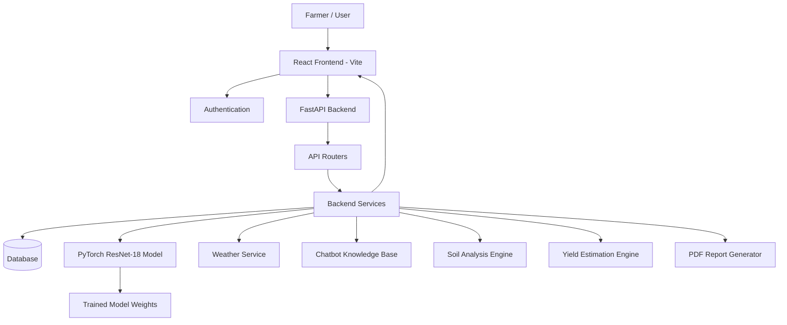

# 🌱 AI-Powered Intelligent Crop Health & Precision Farming Platform

<p align="center">
  An intelligent agriculture platform combining deep learning, computer vision, soil analysis, weather intelligence, and precision farming tools to support smarter agricultural decisions.
</p>

<p align="center">
  
  
  
  
</p>

---

## 📌 Project Overview

The **AI-Powered Intelligent Crop Health & Precision Farming Platform** is a full-stack agricultural intelligence application designed to help farmers monitor crop health, identify plant diseases, evaluate soil conditions, and make informed farming decisions.

The platform integrates a trained deep learning model with agricultural rule-based analysis, weather information, recommendation services, and an interactive dashboard.

It provides a unified environment where farmers can manage farm information, upload crop images, review detection history, analyze soil measurements, receive farming recommendations, estimate crop yield, and interact with an agricultural assistant.

The system is designed around a modular architecture consisting of a React frontend, a FastAPI backend, database services, and a PyTorch-based computer vision pipeline.

## 🎯 Project Objectives

- Detect plant diseases using a trained deep learning model.
- Identify supported crop conditions from uploaded leaf images.
- Provide soil health assessments using agricultural reference ranges.
- Generate fertilizer and irrigation recommendations.
- Incorporate weather information into farming workflows.
- Estimate crop yield using soil, weather, crop, and cultivation inputs.
- Maintain farm profiles and historical prediction records.
- Generate downloadable agricultural reports.
- Provide an interactive agricultural chatbot.
- Present farming information through a centralized dashboard.

---

## ✨ Key Features

### 1. Authentication & User Management
- User registration and login.
- Password-based authentication.
- Protected dashboard routes.
- User-specific farm information.
- Farmer profile management.
- Persistent farm and prediction records.

### 2. Farm Data Acquisition
- Add and manage farm information.
- Record farm location and cultivation area.
- Select crops and maintain farm details.
- Enter soil measurements.
- Upload leaf images for disease analysis.
- Retrieve weather information for the selected location.

### 3. AI-Based Plant Disease Detection

The platform uses a trained **PyTorch ResNet-18 convolutional neural network** for plant disease classification.

The computer vision pipeline includes:
- Image upload and validation.
- Image preprocessing and transformation.
- Model loading and inference.
- Crop and class compatibility checks.
- Disease classification.
- Confidence score generation.
- Prediction storage and history tracking.

**Supported crop categories:**
- Apple
- Corn (Maize)
- Grape
- Pepper Bell
- Potato
- Tomato

The trained model covers 18 disease and healthy-condition classes across these six crop categories.

Unsupported crops are handled through an explicitly labelled demonstration fallback. These demonstration results are not genuine model predictions and do not receive fabricated confidence scores.

### 4. Soil Health Analysis

The soil analysis module evaluates farmer-provided measurements against configured agricultural reference ranges.

Parameters include:
- Soil pH
- Nitrogen (N)
- Phosphorus (P)
- Potassium (K)
- Soil moisture

The system provides:
- Soil health scoring.
- Individual parameter evaluation.
- Optimal-range indicators.
- Soil condition summaries.
- Fertilizer guidance.

**Important:** Soil health scoring is rule-based and does not represent a trained machine learning prediction or a substitute for laboratory soil testing.

### 5. Smart Farming Recommendations

The recommendation engine provides guidance across multiple categories:

- Fertilizer recommendations.
- Irrigation recommendations.
- Soil-related recommendations.
- Weather-related guidance.
- Plant disease and treatment-related advisory information.

Recommendations use available soil measurements, weather information, and detection results.

Demonstration-based treatment recommendations are labelled accordingly and must not be interpreted as confirmed diagnoses.

### 6. Crop Yield Estimation

The crop yield module estimates expected agricultural production using:
- Crop selection.
- Cultivation area.
- Season.
- Soil measurements.
- Weather conditions.

The current yield estimation functionality is **rule-based**, using typical crop yields and adjustment factors. It is not a trained machine learning yield prediction model.

Results include estimated yield per hectare and projected total production when cultivation area is provided.

### 7. AI Agronomist Chatbot

The platform includes an interactive agricultural assistant with:
- Conversational interface.
- Chat history.
- Archived conversations.
- Agricultural knowledge-based responses.
- Crop health guidance.
- Soil analysis assistance.
- Disease diagnosis assistance.
- Irrigation guidance.
- Contextual farming information.

The current response engine uses a rule-based agricultural knowledge base. It should not be represented as a Gemini-powered or independently trained language model.

### 8. Prediction History & Reports

The platform maintains historical records of crop detection activities.

Features include:
- Previous prediction records.
- Crop and disease information.
- Confidence scores where available.
- Detection status.
- Demonstration-result identification.
- Historical record management.
- PDF report generation and export.

The reporting utilities also support farm-related information and downloadable summaries.

### 9. Farmer Profile & Farm Management

- View account information.
- Update personal details.
- Maintain farming experience.
- Manage farm records.
- Review saved farm information and cultivation details.

### 10. Interactive Dashboard

The dashboard brings together important farming information:

- Weather overview.
- Leaf scan statistics.
- Farm and crop summaries.
- Soil nutrient status.
- Irrigation guidance.
- Soil pH status.
- Yield estimates.
- Fertilizer guidance.
- Recent leaf scans.
- Disease detector status.

---

## 🧠 Machine Learning & Deep Learning Architecture

### Plant Disease Classification Model

| Component | Implementation |
|---|---|
| Model architecture | ResNet-18 |
| Framework | PyTorch |
| Learning approach | Supervised image classification |
| Training dataset | PlantVillage |
| Crop categories | 6 |
| Classification classes | 18 |
| Model artifact | `resnet18_plantvillage_best.pt` |
| Reported test accuracy | 91.67% |
| Inference | Backend model service |

### Model Training Workflow

The training and inference workflow follows these stages:

1. **Dataset acquisition:** PlantVillage image data is organized into crop disease categories.
2. **Dataset preparation:** Images are grouped according to their classification labels.
3. **Preprocessing:** Images are resized and transformed into the format required by the network.
4. **Dataset splitting:** Training and held-out evaluation data are separated.
5. **Model initialization:** ResNet-18 is configured for the project's classification classes.
6. **Training:** The model learns visual features associated with different plant conditions.
7. **Evaluation:** The trained model is evaluated on held-out test data.
8. **Checkpoint saving:** The selected trained weights are saved as a PyTorch `.pt` checkpoint.
9. **Model loading:** The backend loads the saved model for inference.
10. **Prediction:** Uploaded images are preprocessed and passed through the loaded model.
11. **Postprocessing:** Predicted classes and confidence values are interpreted and returned to the frontend.

### Model Weights

The trained model checkpoint is maintained within the backend ML model directory:

`backend/ml/models/resnet18_plantvillage_best.pt`

The checkpoint contains trained parameters used by the inference pipeline.

**Model evaluation note:** The reported 91.67% accuracy is the project's held-out PlantVillage evaluation result. It should not be interpreted as a guarantee of equivalent accuracy on real-world field images, different cameras, lighting conditions, or unsupported crops.

---

## 🏗️ System Architecture



### Technology Stack

| Layer | Technologies |
|---|---|
| Frontend | React.js, JavaScript |
| Build Tool | Vite |
| Styling | CSS, Tailwind CSS |
| Backend | Python, FastAPI |
| API Communication | REST APIs |
| Machine Learning | PyTorch |
| Model Architecture | ResNet-18 |
| Image Processing | Pillow / Image preprocessing pipeline |
| Database | SQLite, PostgreSQL support |
| Database Migrations | Alembic |
| Weather Integration | Open-Meteo |
| Data Visualization | Recharts |
| Reports | Browser-side PDF generation |
| Version Control | Git, GitHub |

---

## 📂 Repository Structure

```text
AI-Crop-Health-Precision-Farming/
│
├── backend/
│   ├── app/
│   │   ├── main.py
│   │   ├── api/
│   │   ├── models/
│   │   ├── schemas/
│   │   ├── services/
│   │   ├── database.py
│   │   └── ...
│   │
│   ├── alembic/
│   ├── ml/
│   │   └── models/
│   │       └── resnet18_plantvillage_best.pt
│   │
│   ├── scripts/
│   ├── tests/
│   ├── uploads/
│   ├── requirements.txt
│   └── ...
│
├── frontend/
│   ├── public/
│   ├── src/
│   │   ├── assets/
│   │   ├── components/
│   │   │   ├── chatbot/
│   │   │   └── dashboard/
│   │   ├── context/
│   │   ├── layouts/
│   │   ├── pages/
│   │   ├── services/
│   │   └── utils/
│   │
│   ├── package.json
│   ├── vite.config.js
│   └── ...
│
└── README.md
```

*The structure above summarizes the main project areas. Refer to the repository for the complete implementation.*

---

## ⚙️ Installation & Setup

### Prerequisites

Install the following before running the application:

- Python 3.10 or a compatible version required by the backend dependencies.
- Node.js and npm.
- Git.
- A compatible environment for running PyTorch.

### 1. Clone the Repository

```bash
git clone https://github.com/Hamzah1507/AI-Crop-Health-Precision-Farming.git

cd AI-Crop-Health-Precision-Farming
```

### 2. Backend Setup

Open a terminal:

```bash
cd backend
```

Create a virtual environment:

```bash
python -m venv venv
```

Activate it on Windows:

```powershell
venv\Scripts\activate
```

Install dependencies:

```bash
pip install -r requirements.txt
```

Configure the backend environment variables using the project's configuration requirements. Never commit real secrets or production credentials.

Apply database migrations if required by the configured environment:

```bash
alembic upgrade head
```

Start the FastAPI application using the project's configured application entry point:

```bash
uvicorn app.main:app --reload
```

Backend API documentation is normally available at:

```text
http://127.0.0.1:8000/docs
```

### 3. Frontend Setup

Open another terminal:

```bash
cd frontend
```

Install dependencies:

```bash
npm install
```

Configure the frontend API base URL according to the project's API configuration.

Start the development server:

```bash
npm run dev
```

Open the local URL printed by Vite in your browser.

---

## 🔐 Security & Data Management

The project uses protected application routes and backend services for data operations.

Security considerations:

- Do not commit `.env` files.
- Do not expose database credentials or secret keys.
- Do not upload personal user records or private production databases.
- Keep uploaded images and runtime data separate from source control.
- Use appropriate authentication and authorization checks.
- Store sensitive deployment configuration outside the repository.

---

## 🧪 Testing & Quality Assurance

The project includes backend tests covering multiple application areas.

Previously verified backend test suites:

| Test Suite | Tests Passed |
|---|---:|
| API Regression | 34 |
| Chatbot Integration | 7 |
| Library Seeder & Recommendations | 26 |
| Detection Pipeline | 36 |
| Analytics & Reporting | 11 |
| Security & Integrity | 12 |
| Soil Service | 11 |
| Task 4 Audit | 8 |
| **Total** | **145** |

The full backend discovery run was verified with:

```bash
python -m unittest discover -s tests -v
```

Reported result: **145 tests passed, 0 failures, 0 errors.**

Frontend quality checks:

```bash
npx oxlint
npm run build
```

Previously verified results:
- Oxlint: 0 warnings and 0 errors.
- Production frontend build: successful.

These are recorded verification results from the project development environment; they are not a guarantee that every deployment environment will behave identically.

---

## ⚠️ Important Technical Limitations

Transparency about the current implementation:

1. The ResNet-18 disease classifier is trained for six supported crop categories.
2. Unsupported crops use a demonstration fallback and are not genuine AI diagnoses.
3. Soil analysis and soil health scoring are rule-based.
4. Crop yield estimation is rule-based, not a trained ML prediction.
5. The chatbot currently uses a rule-based agricultural knowledge base.
6. Treatment suggestions associated with simulated detection results are demonstration guidance and should not be treated as confirmed diagnoses.
7. PlantVillage evaluation performance may differ from real-world agricultural field performance.
8. Actual production deployment should be tested with its target database, configuration, and infrastructure.

---

## 🚀 Future Enhancements

Potential future development areas include:

- Expanding the disease detection dataset to additional crop categories.
- Training and validating models using real-world field images.
- Improving model generalization under varied lighting and environmental conditions.
- Integrating additional agricultural datasets.
- Developing a dedicated machine learning yield prediction model.
- Enhancing agricultural conversational intelligence.
- Introducing advanced farm analytics and monitoring.
- Adding deployment monitoring and model performance tracking.
- Supporting mobile-based crop monitoring.

---

## 👨‍💻 Developer

**Hamzah Saiyed**

AI/ML & Full-Stack Development

GitHub: [@Hamzah1507](https://github.com/Hamzah1507)

Project Repository: [AI-Crop-Health-Precision-Farming](https://github.com/Hamzah1507/AI-Crop-Health-Precision-Farming)

---

## 📄 License

No open-source license has been specified yet. All rights remain with the project owner unless a license is added to this repository.

---

<p align="center">
  <b>AI-Powered Intelligent Crop Health & Precision Farming Platform</b><br/>
  Building smarter agricultural decisions through AI, computer vision, and precision farming technology. 🌱
</p>
